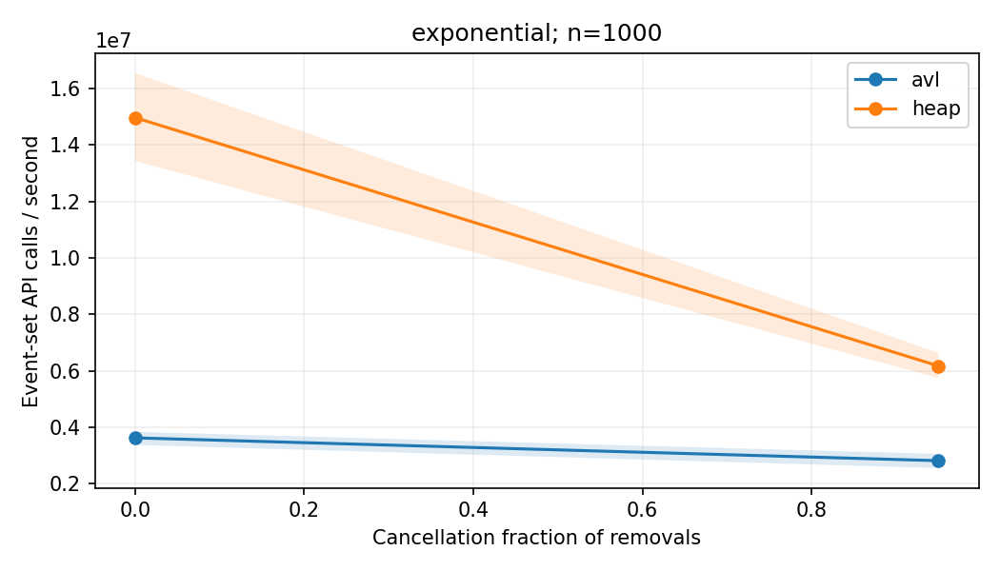
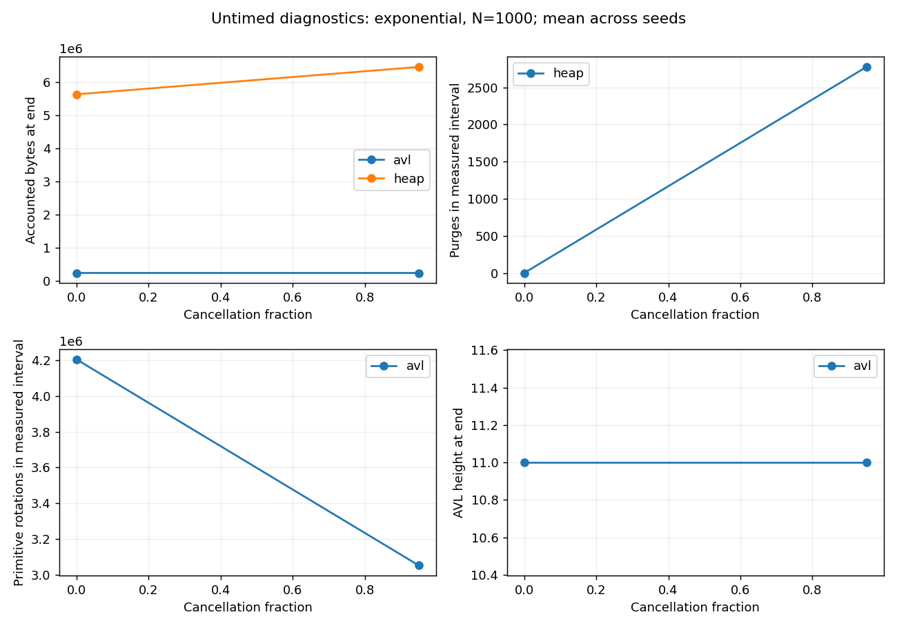

# CS 253 / MA 253 Lab Project 9
## Event Scheduler: Heap and AVL Evaluation

**Language:** C++17  
**Benchmark environment:** Linux x86-64, GCC 14.2.0, -O2 -Wall -Wextra -Wpedantic

> **Scope of this report.** The submission contains two related but distinct implementations. The simulator and primary event-set classes are under include/, src/, and app/. The newer benchmarking harness under benchmark/ adapts separately uploaded heap and AVL code. The performance results below measure those benchmark adapters, not the primary src/structA/HeapEventSet and src/structB/AvlEventSet classes. This distinction is essential when interpreting the comparison.

## 1. Team and contributions

The table lists the team members by name and roll number. Representative commits document the contributions attributed to each member.

| Team member (roll no.) | Recorded contribution | Representative commit |
|---|---|---|
| Swarna Dhankhar (250001070) | Structure A heap and custom hash set; amortized-cost derivation D1 | [9384389](https://github.com/PeterParker38/cs253-duckdsa-p09/commit/9384389), [3b3d1ab](https://github.com/PeterParker38/cs253-duckdsa-p09/commit/3b3d1ab) |
| Saumya Roy (250001064) | Structure B AVL implementation and height-bound derivation D2 | [e276154](https://github.com/PeterParker38/cs253-duckdsa-p09/commit/e276154), [9d0591a](https://github.com/PeterParker38/cs253-duckdsa-p09/commit/9d0591a) |
| Jambula Pranav Reddy (250001034) | Sender simulator and ordering derivation D3 | [475df38](https://github.com/PeterParker38/cs253-duckdsa-p09/commit/475df38), [1a477f0](https://github.com/PeterParker38/cs253-duckdsa-p09/commit/1a477f0) |
| Simran Malviya (250001066) | Sorted-array oracle, differential tests, and AVL checker derivation D4 | [703323f](https://github.com/PeterParker38/cs253-duckdsa-p09/commit/703323f), [8487740](https://github.com/PeterParker38/cs253-duckdsa-p09/commit/8487740), [bb7ea9d](https://github.com/PeterParker38/cs253-duckdsa-p09/commit/bb7ea9d) |
| Henil Shah (250001065) | AVL and heap adversarial generators; rotation-bound derivation D5 | [cec1312](https://github.com/PeterParker38/cs253-duckdsa-p09/commit/cec1312), [6d0111c](https://github.com/PeterParker38/cs253-duckdsa-p09/commit/6d0111c), [914627d](https://github.com/PeterParker38/cs253-duckdsa-p09/commit/914627d) |
| Piyushi Jagga (250001055) | Benchmark integration, validation records, analysis, and results | [0a0f347](https://github.com/PeterParker38/cs253-duckdsa-p09/commit/0a0f347), [34c9b48](https://github.com/PeterParker38/cs253-duckdsa-p09/commit/34c9b483c52de75e5860eae05106aafef34dfa46) |

## 2. Problem and scope

The application is a discrete-event sender simulation. It schedules packet sends, acknowledgement arrivals, and retransmission timers in event-time order. When an acknowledgement arrives, the simulator cancels that packet’s remaining timers. A common EventSet interface lets the simulator use either the binary heap or AVL implementation.

The data-structure project and the benchmark answer different questions. The simulator exercises the project’s integral-timestamp Event type and exact-event cancellation contract. The benchmark/ harness uses a smaller event containing a floating-point time and unique ID so that it can replay generated workloads across an uploaded heap, an uploaded AVL tree, and a reference set. Its performance results therefore characterize the integrated benchmark variants and their auxiliary indexes.

The benchmark varies the live queue size, increment distribution, and cancellation fraction. The focused longer measurements cover one queue size and two cancellation settings; a separate exploratory grid covers more settings but has short runs. The evidence supports conclusions about these tested versions and conditions only.

## 3. Interface, ordering, and invariants

In the simulator-facing interface, an event stores an integer timestamp, a monotonically assigned sequence number, an event type, and a packet identifier. Events compare lexicographically by (time, seq). The sequence number makes equal-timestamp processing deterministic. successor(t) is inclusive: it returns the least event whose time is at least t. Cancellation is requested with the exact event.

The primary Structure A implementation is a binary min-heap with lazy cancellation. The heap stores physical entries; a custom hash set records cancelled sequence numbers and another tracks which sequence numbers remain physically present. If P is physical entries and C is cancelled entries still in the heap, the live size is L = P - C. A cancellation-triggered purge occurs when C > L. The purge retains live events and rebuilds the heap. The primary heap also removes cancelled entries when they reach the root. Its source does not enforce the purge threshold after every successful live deleteMin, so the threshold is not a claim that P <= 2L holds after every arbitrary operation.

The primary Structure B implementation is an AVL tree ordered by (time, seq). It maintains strict search-tree ordering, cached heights consistent with child heights, and balance factors in [-1, 1]. Cancellation removes the exact event; a two-child deletion replaces the node’s event with its in-order successor. The validator checks ordering, heights, and balance independently of operation return values.

The benchmark adapters have additional, materially different invariants. The benchmark heap uses two chained ID sets with 100,000 fixed buckets each and checks the purge threshold after cancellation and after returning a live minimum. The benchmark AVL uses a dynamically growing chained ID-to-event map to support cancellation by ID. Consequently, its heap purge includes fixed-bucket clearing work, and its memory footprint includes the bucket arrays. Those benchmark-specific choices are not inherent properties of a binary heap or AVL tree.

## 4. Structure A: binary min-heap with lazy cancellation

The primary heap stores events in a dynamically growing array and restores heap order with sift-up and sift-down. The custom hash set is implemented in project code rather than delegated to std::unordered_set. Cancellation marks an event by sequence number; it does not immediately remove the event from the array. A later minimum operation skips marked roots, while a purge filters the array and rebuilds the heap in linear time.

The purge trigger uses a strict inequality: it acts when cancelled entries outnumber live entries. At the boundary C = L, no purge occurs. The heap adversary intentionally keeps the two counts equal, demonstrating the edge case rather than representative application traffic. In the primary implementation, purging is initiated from cancel; the benchmark adapter also enforces the condition after a live minimum is removed. Results from the two classes must not be conflated.

Insertion takes O(log P) heap work. A delete-min can discard several cancelled roots before returning a live event; if it discards k tombstones, it performs O((k+1) log P) heap work in that call, with each tombstone's removal chargeable once across the sequence of operations. Cancellation has expected O(1) hash bookkeeping when no purge is triggered, but a purge costs O(P) and can cause a latency spike. Size is O(1), while successor scans O(P) entries with hash membership checks. Any amortized bound for the purge policy depends on exact trigger points and hash-set costs; the primary implementation’s D1 proof should be read with those implementation assumptions.

## 5. Structure B: AVL balanced search tree

The primary AVL implementation stores one event in each node and maintains its height after insertion and deletion. Rotations restore the balance invariant. Its ordering key is (time, seq), and its timestamp successor search uses the inclusive time >= t condition.

Insertion, delete-min, cancellation by exact key, and successor search follow paths whose length is bounded by the AVL height, giving O(log L) worst-case tree work. This does not mean cancellation by arbitrary ID is automatically logarithmic: the primary public interface cancels by full event key. In the benchmark adapter, a separate ID map first resolves an ID to an event and then the AVL tree deletes by key. The map’s expected lookup cost and memory are part of the benchmarked implementation.

The AVL adversary records primitive rotations, counting the two component rotations in a double rotation separately. The benchmark’s AVL adapter retains the uploaded tree algorithm but wraps it with independent per-instance counters, cleanup, validation, and the ID map described above.

| Operation | Primary heap | Primary AVL |
|---|---|---|
| Insert | O(log P) | O(log L) worst case |
| Delete minimum | O((k+1) log P) if k cancelled roots are skipped; tombstone work amortizes across removals | O(log L) worst case |
| Cancel | Expected O(1) bookkeeping, except O(P) purge work when triggered | O(log L) for exact event-key cancellation |
| Successor | O(P) scan | O(log L) worst case |
| Size | O(1) | O(1) maintained count |

The table describes the primary classes and omits benchmark-adapter index costs. For the integrated benchmark AVL, cancelling by ID adds an expected hash-map lookup before AVL deletion. The integrated benchmark heap also pays fixed-bucket clearing cost at each purge.

## 6. Beyond the lecture: Jones’s hold-model method

Jones’s paper describes the core hold model as repeatedly removing the minimum item and reinserting it with its priority increased by a random increment. This keeps the queue size fixed and measures the average cost of a remove-and-insert cycle as queue size and the increment distribution vary. The project’s benchmark implements that core workload at cancellation rate zero: it deletes the minimum and inserts a replacement at the removed time plus a sampled increment. [Jones, “An Empirical Comparison of Priority-Queue and Event-Set Implementations”](https://www.cs.odu.edu/~cmo/classes/old/cs475sp05/papers/jones86.pdf)

The project extends this workload with a cancellation mixture. At rate r, each cycle chooses a random live event for cancellation with probability r; otherwise it removes the minimum. It then inserts one replacement event. Queue size remains constant. The generated trace is shared between the heap and AVL adapters, and each replacement receives a new ID that also acts as its tie-breaking sequence.

This is a limited adaptation of the hold-model workload, not a reproduction of Jones’s full experimental protocol. Jones describes five increment distributions with expected value one, constructs an initial queue through a randomized queue-building process, measures 1,000 trials, repeats measurements three times, and calibrates loop overhead for subtraction. This project uses four distributions with mean one, initializes the queue by inserting independently sampled times, uses a fixed 10,000-cycle warm-up and 3,000,000 measured cycles for the focused runs, and does not subtract loop or random-number overhead. Its distributions share broad categories with Jones’s (exponential, uniform, bimodal, and triangular), but the parameterizations are not the same; the biased distribution in Jones’s table is not included. The report therefore claims use of the core hold-model pattern and an extension, not a faithful replication of Jones’s results.

| Method choice | Jones (1986) | Project benchmark |
|---|---|---|
| Basic cycle | Remove minimum; increment its priority; reinsert | At 0% cancellation, remove minimum; insert a new event at removed time plus increment |
| Queue initialization | Randomized enqueue/dequeue construction intended to yield representative queue shape and near steady-state priorities | Insert N events with independently sampled times |
| Increment distributions | Five mean-one distributions, including a biased distribution | Four mean-one distributions; same broad categories for four cases, different parameterizations |
| Queue sizes | For most implementations, 28 exponentially spaced sizes from 1 to 11,585 | Focused run N=1,000; exploratory runs N=100, 1,000, 10,000 |
| Timing protocol | 1,000 trials, three repeats, and loop-overhead calibration/subtraction | 3,000,000 timed cycles, five paired seeds, 10,000 warm-up cycles; no overhead subtraction |
| Added project workload | No cancellation mixture in the basic hold model | Random cancellation mixture at the configured rate, with one replacement per cycle |

This comparison makes the scope of the adaptation explicit: the benchmark carries over the fixed-size remove-and-reinsert pattern and extends it, while queue preparation, distributions, sizes, and timing controls differ.

## 7. Correctness, validation, and documented integration fixes

The benchmark’s reference implementation uses ordered standard-library containers and is explicitly marked as a harness demonstration, not the project heap or AVL. Before timing, each backend replays the same generated trace against the reference, checks the expected removal or cancellation result, validates structure at sampled intervals, checks constant live size, and compares a final drain. Timed runs exclude trace generation, validation, warm-up, and diagnostic replay.

The recorded validation note in benchmark/docs/TEST_RESULTS.md reports 48 trace configurations: three queue sizes, four cancellation fractions, and four distributions. Each configuration was checked on the reference, heap, and AVL adapters (144 backend validations). It also records same-seed repeatability, structural and index checks, exact drains, targeted cancellation and tie-order contracts, heap purge-boundary regressions, AVL rotation regressions, and rejection of a deliberately corrupted minimum. The note reports AddressSanitizer and UndefinedBehaviorSanitizer passes; LeakSanitizer was disabled because of an environment restriction. The documented CMake path was not tested because CMake was unavailable in that validation environment. These are recorded project results; no new test run was performed for this document.

| Validation dimension | Recorded settings |
|---|---|
| Queue sizes | 1, 10, 100 live events |
| Cancellation fractions | 0%, 50%, 95%, 100% |
| Increment distributions | Exponential, uniform, bimodal, triangular |
| Trace length | 1,000 measured cycles after 100 warm-up cycles |
| Backends per trace | Ordered reference, heap adapter, AVL adapter |

The configuration count is the product 3 × 4 × 4 = 48. The trace is generated once for a configuration and replayed against each backend, so the 144 checks are backend validations, not 144 independent workloads.

The integration note benchmark/docs/INTEGRATION_CHANGES.md records the following corrections and compatibility work. Current source confirms the resulting implementation details; the earlier uploaded files themselves are not present in the tracked repository for an independent before-and-after comparison.

| Recorded issue or compatibility need | Current integrated handling |
|---|---|
| AVL left-rotation counts were missing for some rotations. | The benchmark tree increments the left-rotation counter in rotL; double rotations count both primitive rotations. |
| The uploaded examples contained demonstration entry points and incomplete lifetime management. | The benchmark adapter owns each tree instance and clears it at destruction. |
| The benchmark cancels by ID, while the uploaded AVL cancellation takes a full event key. | The AVL adapter uses a custom growing ID-to-event map before tree deletion. |
| The original heap cancellation behavior did not match the benchmark’s repeated-cancel contract, and the purge check needed to run after a live minimum changes the live count. | The adapter rejects already-cancelled IDs and checks the purge threshold after cancellation and after a live minimum. |
| The workload uses fractional increments and needs comparable event outputs. | The benchmark event uses double time and a unique ID; trace generation, validation, and checksums apply identical events to each backend. |

## 8. Adversarial inputs

The AVL adversary generates monotonically increasing, sawtooth-zigzag, and seeded uniform-random insertions at sizes from 1,000 to 500,000. At 500,000 insertions, the monotonic stream records 499,981 primitive rotations (0.999962 per insertion) and height 18. The sawtooth stream records 249,982 rotations (0.499964 per insertion) and height 18. The random stream records 349,576 rotations (0.699152 per insertion) and height 22. These are recorded counts from results/raw/avl_adversary.csv; they stress update paths but do not establish typical application rotation rates.

The heap adversary performs 250,000 iterations of inserting two events and cancelling one. At the final sample it has inserted 500,000 events, cancelled 250,000, and retains 250,000 live plus 250,000 cancelled physical entries. It records zero purges and a physical-to-live ratio of 2.00. This is the exact C = L threshold case for the primary heap’s cancellation-triggered purge rule.

The separate seeded “benign_random” run at the same target iteration count is not a matched workload: it ends with only two live and two physical entries after 127,757 purges. Its final ratio is 1.00, but that endpoint should not be read as a controlled performance comparison. The CSV records both endpoints; no general workload distribution is inferred from them.

## 9. Predicted-cost model

The project’s D6 document models N as live queue size, M as measured cycles, r as the cancellation fraction, H as physical heap entries, and C as stale entries. It predicts that both structures have logarithmic tree/heap work for insertions and ordinary minimum removals, with implementation-dependent constants and memory effects. It treats the model as a directional prediction, not a fitted curve.

For the benchmark heap, one useful total-work decomposition is

T_heap ≈ M·a_i·log(N+1) + (1-r)M·a_d·log(N+1) + rM·a_c + K·a_s·log(N+1) + a_p·S + lookup/allocation overhead,

where K is the number of stale entries removed individually at the root and S is the total number of physical entries scanned by purges. The benchmark adapter has two fixed arrays of 100,000 hash buckets, and each purge clears both. Therefore purge cost includes a term proportional to the number of purges times bucket count, in addition to scanning physical heap entries. The generic O(H) purge description alone understates this adapter’s work at small queue sizes.

For the AVL adapter, insertion and minimum removal traverse tree paths; cancellation also uses the ID map before deleting a key. The index and event payload layouts affect both work and accounted storage. The prediction that array locality may favor a heap, while immediate AVL deletion may help under some cancellation mixes, is a hypothesis. The measurements do not prove a cache mechanism or require a crossover.

The D6 document argues that each stale entry is removed at most once, either from the root or during purge, and that purges triggered at C > L can charge a linear heap rebuild to the cancelled entries being discarded. That amortized argument is conditional on the exact purge behavior and hash implementation. The note itself qualifies the fixed-bucket clearing cost and does not claim a uniform constant-time hash cost for arbitrary collision patterns.

## 10. Experimental setup

The focused dataset is stored in benchmark/results/team_long/. It uses the team benchmark mode with N=1000, exponential increments of mean one, cancellation fractions r=0 and r=0.95, 3,000,000 measured cycles, 10,000 warm-up cycles, and five paired seeds per setting. Each cycle includes one cancellation or minimum removal and one insertion. The benchmark’s reported API-call throughput is 2 × cycles / elapsed seconds; generation, pre-timing backend validation, warm-up, and diagnostic replay are outside the measured interval. Backend order rotates across paired repeats.

The generator supports four mean-one increment distributions: exponential -ln(1-u); uniform [0,2); a 50/50 mixture of uniform [0.1,0.3) and [1.7,1.9); and a symmetric triangular distribution on [0,2] with mode 1. The long focused result measures only the exponential distribution. A separate exploratory dataset spans queue sizes 100, 1,000, and 10,000; 12 cancellation fractions from 0% through 95%; all four distributions; and five paired seeds. It has 5,000 measured cycles and 2,000 warm-up cycles per trial.

| Distribution | Generator | Mean |
|---|---|---:|
| Exponential | -ln(1-u) | 1 |
| Uniform | 2u on [0,2) | 1 |
| Bimodal | Equal mixture of [0.1,0.3) and [1.7,1.9) | 1 |
| Triangular | Symmetric triangular on [0,2], mode 1 | 1 |

Here u is drawn uniformly from [0,1). The benchmark uses the same distribution generator for queue initialization and for replacement-event increments. The focused results do not compare the four distribution families; they report the exponential case only. The broader grid provides coverage across families, but its short timed interval limits performance interpretation.

The focused build metadata records Linux 6.18.57 x86-64 with glibc 2.41, GCC 14.2.0, and -std=c++17 -O2 -Wall -Wextra -Wpedantic. The environment record does not identify a CPU model or cache sizes. The timer is std::chrono::steady_clock; the benchmark does not use __rdtsc. Diagnostics, including accounted memory, purge counts, rotations, and height, are collected in a separate replay outside the timer.

## 11. Results and comparison with predictions

### Focused longer runs

The long dataset contains 20 timed trials: five seeds for each backend at each of two settings, or ten matched heap/AVL pairs. The reported speedup is the mean of paired AVL time / heap time ratios, not the ratio of the displayed mean times.

| Cancellation fraction | Mean heap time (s) | Mean AVL time (s) | Mean paired heap speedup | Approx. 95% bootstrap interval |
|---:|---:|---:|---:|---:|
| 0% | 0.407 | 1.663 | 4.13× | 3.78–4.48× |
| 95% | 0.978 | 2.154 | 2.23× | 1.94–2.53× |

| Cancellation fraction | Heap mean API calls/s | Heap standard deviation | AVL mean API calls/s | AVL standard deviation |
|---:|---:|---:|---:|---:|
| 0% | 14,967,779 | 2,061,025 | 3,627,443 | 292,838 |
| 95% | 6,174,327 | 534,337 | 2,819,197 | 332,996 |

These throughput means come from the backend summary CSV. Because each measured cycle has two event-set API calls, the reported API-call rate is twice the measured cycle count divided by elapsed time. The paired speedup is computed separately as the mean of five per-seed time ratios, so it need not equal the ratio of the displayed throughput means.

For these integrated implementations at N=1000 with exponential increments, the heap was faster in both measured conditions. The high-cancellation result is slower for both structures than the pure hold case. This data does not show that the heap always wins: only one live size and two cancellation settings received these longer runs. Five pairs give limited uncertainty information, and the bootstrap intervals do not account for shared-machine effects.

The paired speedup intervals are descriptive percentile-bootstrap intervals computed from five paired ratios. They do not remove shared-machine bias or establish a universal ordering. At 95% cancellation the paired speedup is the mean of the per-seed AVL-time/heap-time ratios; it is not calculated by dividing the mean AVL throughput by the mean heap throughput. The distinction matters because averaging ratios and dividing averages are different summaries.

### Exploratory grid and memory diagnostics

The exploratory run contains 720 paired workloads (1,440 backend trials). Every pair’s checksum matched, and the validation record reports that every trial passed validation before timing. All trials were shorter than 0.2 seconds; some overlapped correctness tooling. The project documentation therefore treats this grid as workload coverage and preliminary pattern data, not as reliable performance ranking or crossover evidence.

At N=1000, the focused diagnostic replay reports approximately 5.62 MB of accounted heap storage and 0.238 MB for AVL with no cancellations. At 95% cancellations it reports approximately 6.45 MB and 0.238 MB, respectively. These figures are adapter-accounted storage, not process memory. They exclude allocator metadata and temporary purge peaks. They also compare unlike event layouts: the AVL event includes an inline string field while the heap event does not. The large heap baseline mainly reflects its two fixed bucket arrays, an implementation-specific design choice.

## 12. Limitations

The measured results apply to the integrated adapters in benchmark/src/team/, not directly to the primary classes under src/structA/ and src/structB/. The benchmark adapters add ID indexes, alter event representation, and have purge behavior that differs from the primary heap. They also preserve different payload layouts. The comparison is between these complete integrated implementations, not an isolated abstract heap versus AVL algorithm.

The longer performance evidence covers only N=1000, exponential increments, and 0% or 95% cancellation. The wider grid uses short intervals and should not support precise rankings. The shared-machine environment is recorded, but CPU model, cache sizes, and independent-load guarantees are not. No claim that cache misses caused a particular throughput change is established by these measurements.

The original uploaded benchmark sources referenced by the integration note are not in the tracked repository, so the before-and-after bug history is reported from that note rather than independently reconstructed. The project’s validation record says CMake was unavailable and leaves its CMake build path untested.

Next measurements should extend the long-run design across more queue sizes, increment distributions, and cancellation rates; record machine identity and all run arguments with the raw trials; and preserve the exact source revision used for each experiment. A controlled comparison should also align event payloads and account for hash-table index design, purge-clearing work, and temporary memory peaks.

## 13. Resources and references

1. Douglas W. Jones. “An Empirical Comparison of Priority-Queue and Event-Set Implementations.” Communications of the ACM, 29(4), 300–311, April 1986. [DOI 10.1145/5684.5686](https://doi.org/10.1145/5684.5686). The paper defines the hold-model workload and reports its own measurement protocol.
2. Project’s benchmark integration record: benchmark/docs/INTEGRATION_CHANGES.md.
3. Validation record: benchmark/docs/TEST_RESULTS.md.
4. Focused benchmark results and environment: benchmark/docs/RESULTS.md and benchmark/results/team_long/.
5. Exploratory benchmark records: benchmark/results/team_exploratory/.
6. D6 cost-model document: benchmark/docs/D6_COST_MODEL.md.
7. Primary interface and implementations: include/event_set.hpp, include/event.hpp, src/structA/, src/structB/, and benchmark/src/team/.
8. Formal derivations D1–D6: docs/derivations/D1.pdf through D6.pdf.

## Appendix A. Data provenance

Numerical benchmark claims use the focused data and summaries in benchmark/results/team_long/, exploratory data in benchmark/results/team_exploratory/, and adversary CSVs in results/raw/. Performance explanations are limited to evidence from these measurements and the source code. Jones’s paper is cited for the hold-model description.

